  

  

  
  
  

---

### 👨‍💻 Sobre Mí

- 🎓 **Ingeniero en Sistemas Informáticos** enfocado en arquitecturas limpias, escalables y alto rendimiento.
- 🤖 Enfoque en **Machine Learning e Inteligencia Artificial** (visión por computadora, modelos predictivos y pipelines de datos).
- ⚙️ Experiencia en backend con **FastAPI / APIs REST**, bases de datos relacionales y desarrollo web moderno.

---

### 🛠️ Tecnologías & Herramientas

**Backend & Frameworks**  

  

**Machine Learning & IA**  

  

**Frontend & Web**  

  

**Bases de Datos & DevOps**  

---

### 📊 Métricas de GitHub

  <table border="0">
    <tr>
      <td align="center" width="50%">
        
      </td>
      <td align="center" width="50%">
        
      </td>
    </tr>
  </table>
  
   
  
  

---

### 🎮 Contribuciones

  

